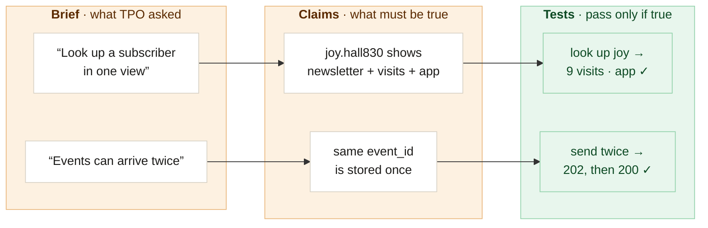
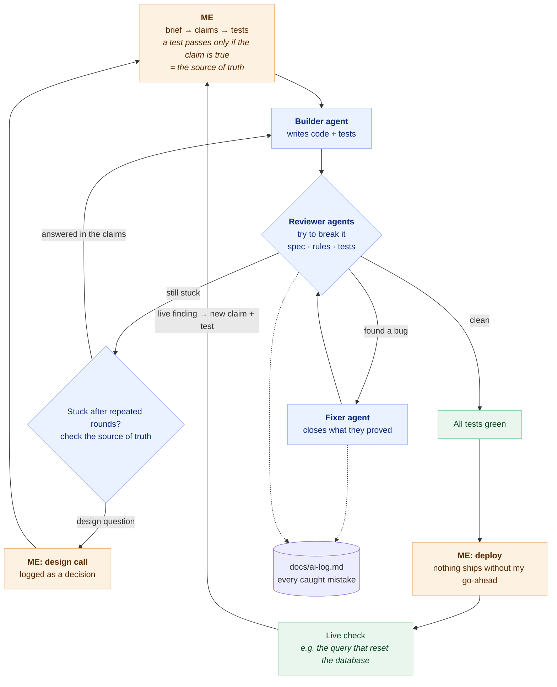

# TPO Mini CDP

A mini customer data platform built for The Pour Over's Full-Stack Developer assessment: three subscriber data sources in one place, a live webhook for app events, segments, and an AI assistant that never sees an email.

## Run locally

Needs Node 22.22 or newer (`.nvmrc`; `wrangler` needs Node 22 and `react-router` 8.4 needs 22.22) and npm. No Cloudflare account: `wrangler` runs workerd and a local D1 file under `.wrangler/`.

```bash
git clone https://github.com/michael-abdo/tpo-cdp && cd tpo-cdp
npm install --legacy-peer-deps      # the flag installs package-lock.json exactly as committed (why: docs/ai-log.md 2026-10-12)
cp .dev.vars.example .dev.vars      # then give all five names a value: any strings work locally (see below)
npm run db:migrate:local            # the eleven migrations into the local D1
npm run db:seed:local               # data/*.csv → seed/*.sql → local D1; prints the counts and every quarantined line
npm run tools:seed -- --local       # the assistant's five tool rows into the local D1 (see below)
npm test                            # every test in workerd against a local D1; no network (count: [Tests](docs/notes.md#tests))
npm run parity -- --local           # the parity oracle against a throwaway local D1; never the dev database
npm run dev                         # http://localhost:5173 (another port: npm run dev -- --port 5174); sign in with the SITE_PASSWORD you put in .dev.vars
```

`npm run dev` keeps running, so run anything after it in a second terminal; stop it with Ctrl-C. `npm test` does not need the dev server or the seed. A plain `npm install` also works today (checked with npm 10.9 and 11.6), but npm 11 then adds `"peer": true` lines to the lockfile.

About `.dev.vars`:

- `SITE_PASSWORD`, `SESSION_SECRET`, `WEBHOOK_SECRET`, `PII_KEY_SECRET`: any non-empty strings. The first request fails with a message naming any one that is missing.
- `ANTHROPIC_API_KEY`: a real key only if you want the assistant to answer. For `npm test` any non-empty string works; the tests never call the network, but 71 tests in 4 files that go through the assistant route fail when it is empty (see [Known gaps](docs/notes.md#known-gaps)).

`npm run tools:seed -- --local` writes the assistant's five tool rows (`segment`, `aggregate`, `query_sql`, `pages_new_subscribers_hit_first`, `describe_schema`) into the local D1; run it after the seed. It inserts missing rows and never overwrites one, then fails, naming the row and the fix, if a stored row differs from `scripts/tool-seeds.ts`. A local D1 seeded before the segment tool gained its five new filters (2026-10-14) holds the old `segment` row (no new filter keys); replace it with `npm run tools:seed -- --local --update segment`.

What you see without them: with no tool rows, Ask on "Insights" (`/insights`) answers 500 `no_tools` naming this command; with an empty key, 503 `assistant_unavailable` pointing to the live app; with a key that is not real, 502 `model_error`. The failed call still shows up on the AI audit log page. Everything else works without a key.

With `npm run dev` running, send an app event to the local server from a second terminal (signed with `WEBHOOK_SECRET` from `.dev.vars`, which the script never prints):

```bash
npm run webhook:send -- --event read_story --user u_2b6447a3   # 202 {"accepted":true,"event_id":"…"}; Look up shows it under julia.evans230
npm run webhook:send -- --event read_story --again             # 200 {"accepted":true,"duplicate":true}
```

Then "Techy → App events" (`/events`) lists it within 5 seconds (the page asks for the list every 5 seconds while its tab is in view, and at once on Refresh) and "Look up" (`/lookup`) shows it in her app activity, with no restart.

The session cookie is `Secure`. Chrome and Firefox accept it on `http://localhost`; another browser that refuses it there will not stay signed in locally, and the live app is the fallback.

## Try it (5 minutes)

Sign in (locally or on the live app), then follow the brief's five requirements in order:

| # | Brief | Where | What to look for |
|---|---|---|---|
| 1 | Pulls it together | **Overview** | Sources: 2,995 rows → 2,900 subscribers, 85 deduped, 10 set aside (8 blank, 2 invalid emails, listed under "rows to fix") |
| 2 | Finds anyone | **Look up** | `joy.hall830@protonmail.com`: newsletter info, site visits and app activity in one view; try `joy.hall` (partial) or `joy.hal830` (typo) |
| 3 | Builds a segment | **Segments** | the brief's example (Instagram, haven't opened in 30 days) → 177, then Export CSV |
| 4 | Never sleeps | **Techy → App events** | open "Send a test event", pick an account and an event, press Send → it appears here and in Look up at once, with no restart; or sign and send one from the terminal ([Webhook](docs/notes.md#webhook)) |
| 5 | Talks back | **Insights** | ask the AI assistant the brief's three questions, pin an answer to the board (it re-runs with no AI call); open **Techy → AI audit log** to see exactly what the model received (no emails) |

Then the extras: a Possible duplicates review instead of risky fuzzy merging, and each source's own health chips, both on Overview.

**Waited on purpose:** CSV upload and scheduled syncs, a Settings page for definitions, per-person logins and permissions. See [What I'd do next](docs/notes.md#what-id-do-next).

## Ask the brief's three questions

Open "Insights" (`/insights`) on the live app, or locally with a real key and the tool rows. The brief's three questions are buttons under the Ask bar; a click asks it at once. Or type any question and press Ask. One question per request: each answer starts fresh.

| Question | What comes back | Check it against |
|---|---|---|
| how many Instagram signups went cold last month? | an answer: active Instagram subscribers whose `cold_since` falls in 2026-08-01..31, from the `aggregate` tool | 46 (66 if you ask to include unsubscribed) |
| build me a list of our most engaged readers | a segment: the 487 active subscribers with an engagement score of 50 or more, highest first, with its filters in words, "Open segment" and "Export CSV" (both list it in the same order) | its count equals the same filters on "Segments" |
| which pages do new subscribers hit first? | a table: for subscribers who signed up 2026-08-29..2026-09-28, the first page of their first site visit, counted by page, from the `pages_new_subscribers_hit_first` tool row | a blank first page counts new subscribers with no tracked visit |

Under "Time period · Filters · Definitions", each answer lists the time period, filters and definitions it used, when it used any. "See exactly what the AI saw for this answer" opens the trace on "AI audit log" (`/audit`): every model request and tool call as stored. Search it for `@` and it finds nothing. On the board below, each tile's Options has "Explain this", which fills in a question in the Ask bar and waits for Ask.

## Live app and how to sign in

- App: **https://tpo-cdp.michaelabdo-mail.workers.dev**
- Webhook: `POST https://tpo-cdp.michaelabdo-mail.workers.dev/webhooks/app` (headers and signing examples under [Webhook](docs/notes.md#webhook))

Open the app and sign in on its login page with the site password. The password and the webhook signing secret come in the submission email; neither is in this repo. A session lasts 12 hours; "Log out" ends it sooner **in that browser** — it only clears that browser's cookie, so a copied cookie stays valid until its own 12-hour expiry (see [Known security gaps](docs/notes.md#known-security-gaps) #1, until per-person sessions ship). More than ten sign-in attempts a minute from one address get a "wait a minute" message.

## How it was built

**1. Brief → claims → tests.** Each line of the brief became a claim (what must be true), and each claim became a test that passes only if the claim is true. Those tests are what the AI agents built against.



**2. The build loop.** A builder agent wrote the code, reviewer agents tried to break it, and a fixer closed what they proved. Work that stayed stuck after repeated rounds was checked against the claims; a real design question came to me and became a logged decision. Nothing deployed without my go-ahead, and a live finding fed back in as a new claim and test. Every caught AI mistake is in [`docs/ai-log.md`](docs/ai-log.md); the full story is in [`docs/notes.md`](docs/notes.md#how-this-was-built).



## Where the AI was wrong

Every AI mistake that was caught is logged in [`docs/ai-log.md`](docs/ai-log.md): what was asked, what was wrong, how it was caught, and the fix.

> **The one to read first: a timeout is not a cancel.**
> In production, the assistant wrote a comma join, `SELECT COUNT(*) FROM v_profiles, v_web_events WHERE v_profiles.status = 'active'`: about 26 million row pairs. The 3-second timer fired and the user saw "too heavy", but D1 can't cancel a query, so it kept running until D1's CPU limit reset the database.
> **The fix stops the bad shape before it runs:** a JOIN may match only on the person key (`pkey` or `visitor_hash`) and must link the view it brings in; no comma lists, no OR in a join, no view joined to itself; a correlated lookup only by an identity column (commit `1200107` and the rounds after it; details in [Known gaps](docs/notes.md#known-gaps)).

## One security concern: the AI's database user

D1 is SQLite, which has no users or roles. So the SQL the model writes runs on the same database connection as the raw tables that hold emails, and only my code (Gates 2 and 3) keeps it to the email-free views. In production I'd use Postgres with a read-only user for the AI:

```sql
CREATE ROLE ai_reader LOGIN;
GRANT SELECT ON v_profiles, v_web_events, v_app_events, v_funnel, v_source_app_conversion TO ai_reader;
-- no grant on the raw tables (subscribers, profiles, app_users, web_events, app_events, …)
ALTER ROLE ai_reader SET statement_timeout = '3s';
```

Then the database itself refuses the raw tables, and its statement timeout really cancels a slow query. The code gates become a second wall instead of the only one.

## More

Everything past running it lives in [`docs/notes.md`](docs/notes.md): how it is built, how each requirement is met, the data rules, the webhook spec, the PII design, the tests, the known gaps, and how AI built it. [`docs/ai-log.md`](docs/ai-log.md) records every AI mistake that was caught.
